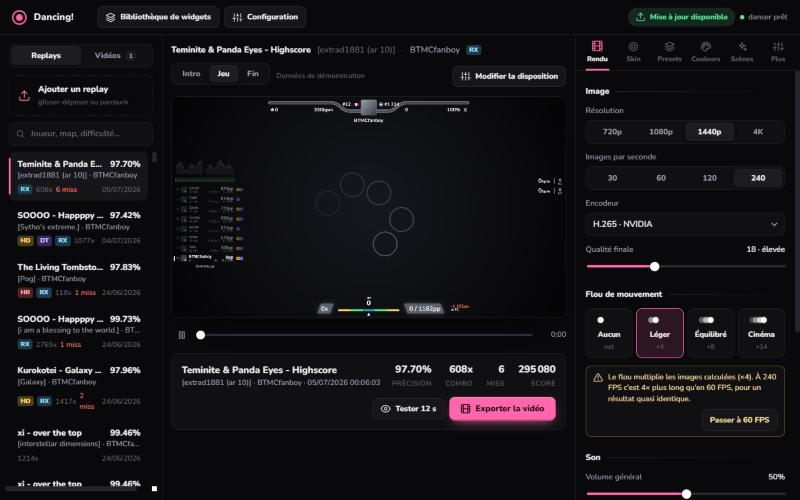
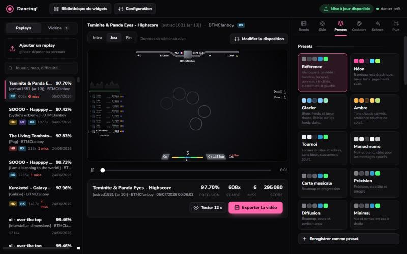
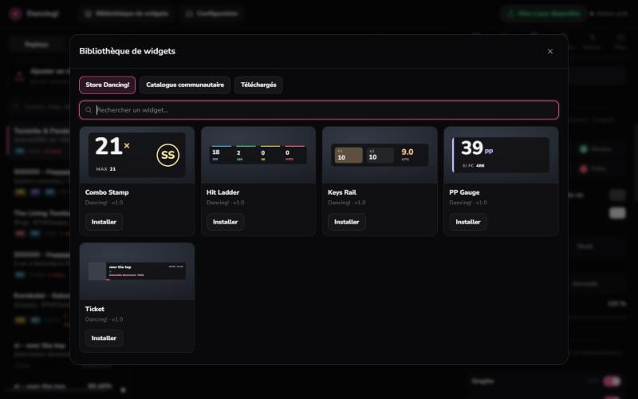
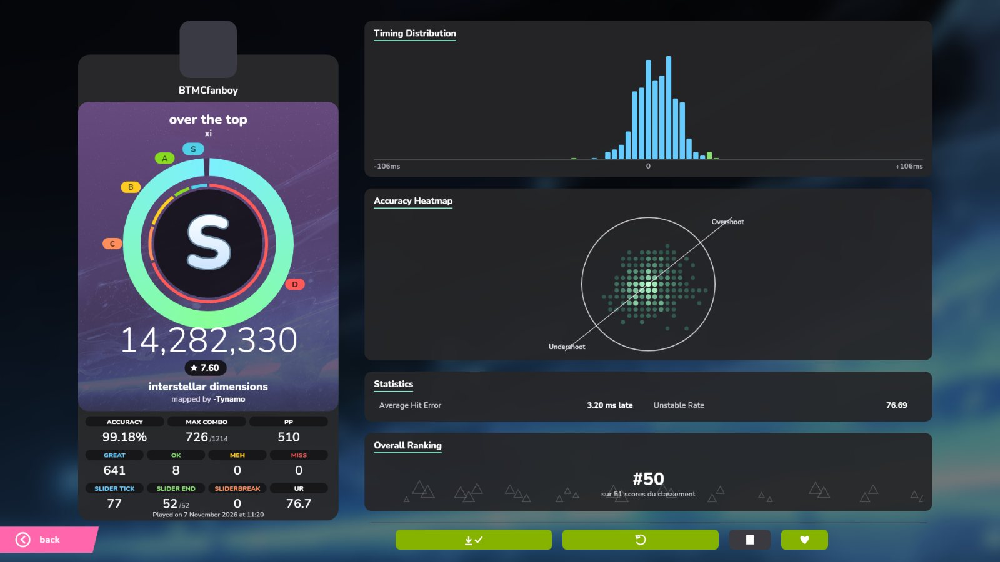

# Dancing!

**Transforme tes replays osu! en vidéos prêtes à poster : overlay animé, intro, écran de fin et widgets tosu.**

## Installation

1. Télécharge **`Dancing!-Setup.exe`** dans la [dernière release](https://github.com/Underspace1/Dancing/releases/latest).
2. Lance-le et choisis le dossier d'installation.
3. Ouvre Dancing! : il trouve tout seul ton dossier osu! (Songs, Skins, Replays).

Rien d'autre à installer : danser, tosu, Node et ffmpeg sont fournis. Quand une nouvelle version sort, Dancing! te propose de la mettre à jour au démarrage, en un clic. Tes réglages, vidéos et widgets sont gardés.

## Ce que ça fait

- **Rendu de replay** : danser rejoue le .osr. Dancing! dessine par-dessus un overlay synchronisé à l'image près : score, combo, pp en direct et si FC, barre d'erreur, touches, classement de la map, graphique de difficulté.
- **Presets** : plusieurs styles prêts à l'emploi (Référence, Néon, Glacier, Ambre, Tournoi…) avec miniature, entièrement personnalisables (couleurs, formes, disposition à la souris).
- **Intro et fin animées** : carte de la map avant le replay. L'écran de fin a deux styles : *Loupe* (note dans un cercle en verre, score détaillé, classement) ou *Classique* (répartition des frappes, carte de précision).
- **Classement global** de la map affiché sans rien configurer.
- **Widgets tosu** : catalogue officiel de tosu, store Dancing! (widgets en verre dépoli : PP Gauge, UR Bar, Strain Graph, Map Stats…) et créateur de widgets sans code. Ils tournent sur les données du replay, dans l'aperçu comme dans la vidéo.
- **osu!mania** : rendu complet des replays mania avec thèmes d'overlay exclusifs, intro et résultats.
- **Aperçu 12 s** avant le rendu complet, musique de la map sur l'intro et la fin, flou de mouvement calculé sur GPU.

| Presets | Store de widgets | Écran de fin |
|---|---|---|
|  |  |  |

## Utilisation

1. Choisis un replay dans la liste (ou dépose un `.osr`).
2. Choisis un preset, ajuste les couleurs et la disposition dans l'onglet **Style**.
3. Règle la résolution, l'intro et la fin dans l'onglet **Vidéo**.
4. **Aperçu 12 s** pour vérifier, puis **Exporter la vidéo**. Le fichier arrive dans le dossier `videos/`.

## Pour les développeurs

Dancing! est une application Tauri autour d'une interface web servie par `server.mjs` (Node, port 24070).

| Fichier | Rôle |
|---|---|
| `server.mjs` | serveur local : replays, rendu, réglages, API osu! |
| `compose.mjs` | redessine l'overlay image par image et le fusionne à la vidéo de danser (ffmpeg) |
| `web/hud.js` | moteur de dessin unique (vidéo, aperçu, overlay tosu) |
| `web/scenes.js` | intro et écrans de fin |
| `extras.mjs` | widgets tosu, store, compte osu!, mises à jour |
| `mania*.mjs`, `web/mania.js` | moteur osu!mania |
| `patch/danser-hud.patch` | export HUD ajouté à danser-go |
| `app/` | coque Tauri et installateur |

Détails techniques : [docs/TECHNIQUE.md](docs/TECHNIQUE.md).

### Publier une version

1. Monte la version dans `package.json` (c'est elle que l'appli compare aux releases).
2. Construis l'installateur : `powershell -ExecutionPolicy Bypass -File build-installer.ps1`.
3. Crée une release GitHub avec le tag `vX.Y.Z` et joins `dist/Dancing!-Setup.exe`. Les installations existantes la proposent au démarrage suivant.

## Crédits et licences

- [danser-go](https://github.com/Wieku/danser-go) de Wieku (GPL-3.0), modifié pour exporter les données de l'overlay. Le patch est dans `patch/`, et les sources modifiées sont livrées avec l'application.
- [tosu](https://github.com/tosuapp/tosu) (LGPL-3.0), voir `third-party/tosu-LICENSE.txt`.
- Police [Nunito](https://fonts.google.com/specimen/Nunito) (SIL Open Font License).

Dancing! n'est pas affilié à osu! ni à ppy Pty Ltd.
